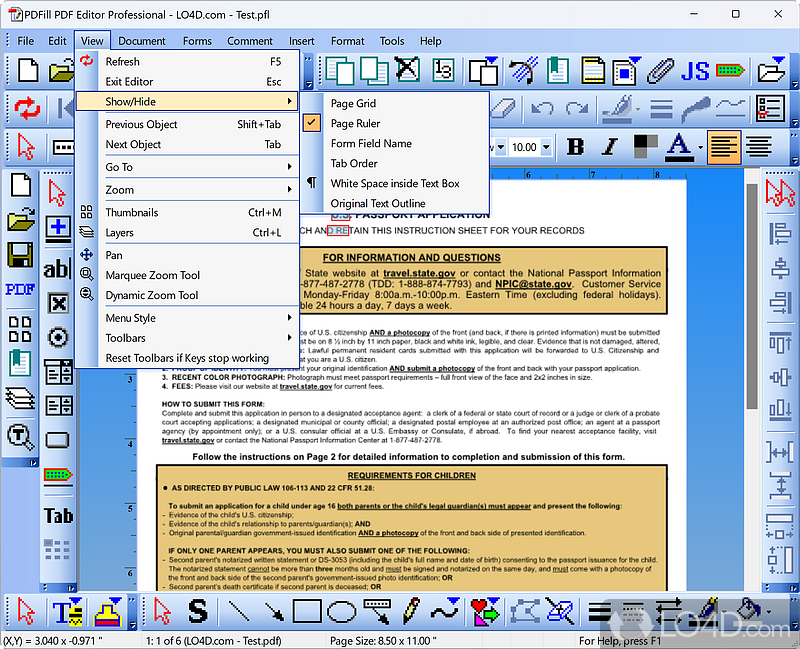
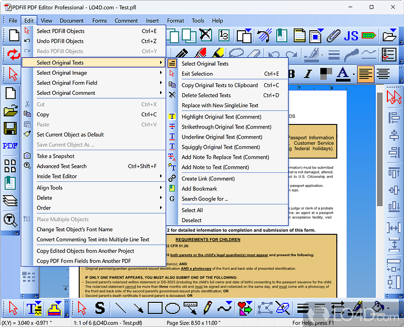

# PDFill Connects Printing, Forms and Page Operations

PDFill brings several Windows PDF workflows together: creating a document through printing, filling a form, and processing existing pages.
Choose the component around the result you need, then keep an editable source and a separate delivery copy.

[](https://pdfill-pdf-tools.github.io/PDFill/)

## Create the PDF from the right source

When the content still lives in a word processor or spreadsheet, correct it there first.
Printing an already incorrect layout to PDF preserves the problem.
Check paper size, orientation, margins, and the selected print range before creating the file.

PDFill's Free PDF & Image Writer creates output through a printable Windows application.
Free PDF Tools processes existing documents, while PDFill PDF Editor supplies editing and form workflows.
The editor's Free Basic, Professional, and Enterprise editions have different capabilities.

| Component | Starting material | Suitable work | Decision before saving |
| --- | --- | --- | --- |
| PDF & Image Writer | A printable application's document | Create a PDF or image through printing | Paper size and print range |
| Free PDF Tools | Existing PDFs or images | Page processing, conversions, and form utilities | Which operation and output file |
| PDF Editor Free Basic | An existing PDF or form | Basic filling, text, comments, and form creation | Whether the available controls meet the task |
| Registered PDF Editor | An existing PDF or form | Additional editing and batch operations | Required edition and registration |

Use the publisher's version comparison for the exact feature boundary.
A capability listed for the registered editor should not be assumed to belong to every free component.
Keep the chosen edition in your notes when reproducing a workflow.

### Understand the output boundary

Reopen the created PDF and compare it with the source application's print preview.
Inspect a dense table and the last page, where clipped content is easy to miss.
If the recipient needs to revise formulas or paragraph styles, retain the original Office document too.

For technical context, qpdf's [QPDFWriter.hh](include/qpdf/QPDFWriter.hh) defines its PDF-writing interface.
[PDFVersion.hh](include/qpdf/PDFVersion.hh) represents PDF version information.
Its input abstractions are [InputSource.hh](include/qpdf/InputSource.hh), [FileInputSource.hh](include/qpdf/FileInputSource.hh), and [BufferInputSource.hh](include/qpdf/BufferInputSource.hh).

These references separate reading a source from writing a PDF.

## Keep a form fillable until the answers are final

Open a copy of the blank form and identify the fields the recipient must complete.
PDFill's editor can fill and save interactive forms.
Before distributing a reusable template, test text entry, checkboxes, and movement between fields.

### Preserve the difference between fields and visible answers

A text box placed on a page and a form field can look similar while behaving differently.
Test the saved document by reopening it and trying the intended interaction.
Check long names, multiline addresses, and characters outside basic Latin.

- Keep a blank template for another submission.
- Save a filled copy before producing a flattened version.
- Check field values in the saved file rather than only in the current editing session.
- Confirm that a selected checkbox stays selected after reopening.
- Review whether the recipient needs to modify answers later.

PDFill's Free PDF Tools includes listing, deleting, and flattening form fields.
Flattening turns the fields' visible appearances into page content and removes their interactive role.
Deleting fields is a different operation and can remove answers you intended to keep.



### Verify the completed copy

Open the flattened result in a separate viewer and check every populated field.
Look for missing appearances, clipped characters, and shifted alignment.
Flattening form fields is not a promise that the entire PDF can never be edited.

qpdf distinguishes document-level forms in [QPDFAcroFormDocumentHelper.hh](include/qpdf/QPDFAcroFormDocumentHelper.hh),
individual fields in [QPDFFormFieldObjectHelper.hh](include/qpdf/QPDFFormFieldObjectHelper.hh), and annotations in [QPDFAnnotationObjectHelper.hh](include/qpdf/QPDFAnnotationObjectHelper.hh).
Those interfaces provide references for the different objects involved in a form.

## Correct orientation before trimming the page

Rotate sideways pages before deciding where their margins should end.
Check content near every edge, especially page numbers, stamps, and handwritten notes.
Work on a copy when experimenting with page geometry.

PDFill Free PDF Tools offers rotation, cropping, and page reformatting.
A crop changes the visible region and should not be treated as a method for removing sensitive information.
If the goal is a smaller printed layout, inspect the result at the intended paper size.

### A native PDFill batch rotation

The documented batch interface is available to registered PDFill PDF Editor users.
In Command Prompt, make the installed PDFill.exe available on PATH before using this example.
The input must contain at least four pages, and the output filename should be unused.

```cmd
PDFill.exe ROTATE "inspection.pdf" "inspection-rotated.pdf" 90 -page "2,4"
```

This requests a 90-degree rotation for the selected pages.
Reopen the saved result to check their orientation and the pages left untouched.
Keep the command on one line and retain quotes around filenames containing spaces.

### Match geometry with page identity

Record both the physical page position and any printed page number.
They can differ when a document includes a cover or introductory pages.
A command targeting page 4 refers to a file position, not necessarily a printed label of 4.

qpdf's page interfaces appear in [QPDFPageDocumentHelper.hh](include/qpdf/QPDFPageDocumentHelper.hh) and [QPDFPageObjectHelper.hh](include/qpdf/QPDFPageObjectHelper.hh).
[QPDFPageLabelDocumentHelper.hh](include/qpdf/QPDFPageLabelDocumentHelper.hh) addresses the separate page-label structure.
This distinction helps explain why renumbering and rearranging are different tasks.

## Reconstruct a two-sided scan in reading order

A scanner without automatic duplex handling can produce separate front and back PDFs.
Before combining them, determine whether the back-side stack was scanned in forward or reverse order.
Check a short numbered sample rather than assuming the feeder's behavior.

PDFill's page tools support merging, splitting, and reordering.
Account for blank backs deliberately so the front-to-back relationship stays correct.

### Interleave a reversed back-side stack with qpdf

This example assumes equal page counts in fronts.pdf and backs-reversed.pdf.
The first file contains odd pages in reading order; the second contains even pages in reverse order.
With qpdf available, the command reverses the second selection and alternates pages into a new document.

```sh
qpdf --empty --collate --pages "fronts.pdf" 1-z "backs-reversed.pdf" z-1 -- "duplex-review.pdf"
```

Use a previously unused output filename.
Here, z denotes the last page, and z-1 selects pages from last to first.
Starting with an empty document does not carry over the inputs' document-level metadata.



### Check navigation after page work

Review the first pair, a middle pair, and the final pair.
Then inspect bookmarks and any references to pages that were removed or moved.
A correct thumbnail order does not guarantee that every navigation target still points to the intended content.

qpdf's bookmark helpers are [QPDFOutlineDocumentHelper.hh](include/qpdf/QPDFOutlineDocumentHelper.hh) and [QPDFOutlineObjectHelper.hh](include/qpdf/QPDFOutlineObjectHelper.hh).
Its tree structures are represented by [QPDFNameTreeObjectHelper.hh](include/qpdf/QPDFNameTreeObjectHelper.hh) and [QPDFNumberTreeObjectHelper.hh](include/qpdf/QPDFNumberTreeObjectHelper.hh).

For automated integrations, qpdf exposes a job interface in [QPDFJob.hh](include/qpdf/QPDFJob.hh),
a C binding in [qpdfjob-c.h](include/qpdf/qpdfjob-c.h), and JSON support in [JSON.hh](include/qpdf/JSON.hh).
These files describe qpdf's interfaces rather than the PDFill batch syntax.

## Choose image resolution around the destination

PDFill converts PDFs to images and images to PDF.
Decide whether the result is a screen preview, a printed page, or material for another processing step.
A full-page image requires enough pixels for its smallest important text.

### Estimate the raster dimensions

PDF page dimensions are commonly expressed in points, with 72 points per inch.
This independent Python calculation estimates the pixels needed for a US Letter page at 200 dpi.
Change the point dimensions and resolution to match the actual job.

```python
from math import ceil
width_pt, height_pt = 612, 792
dpi = 200
width_px = ceil(width_pt * dpi / 72)
height_px = ceil(height_pt * dpi / 72)
print(f"{width_px} x {height_px} pixels")
```

The estimate concerns geometry; it does not select an image encoder or guarantee readable source detail.
Increasing resolution cannot recover information absent from the original scan.
Compare a text-heavy page before exporting an entire document.

### Keep compression separate from layout

JPEG-style image compression can introduce artifacts around thin text and line drawings.
A lossless image format can be preferable for diagrams that will be edited again.
Check actual file size and visual quality together.

qpdf's image and stream pipeline references include [Pl_DCT.hh](include/qpdf/Pl_DCT.hh),
[Pl_Flate.hh](include/qpdf/Pl_Flate.hh), and [Pl_RunLength.hh](include/qpdf/Pl_RunLength.hh).
[QPDFStreamFilter.hh](include/qpdf/QPDFStreamFilter.hh) defines its stream-filter interface.

The core document and object interfaces are [QPDF.hh](include/qpdf/QPDF.hh) and [QPDFObjectHandle.hh](include/qpdf/QPDFObjectHandle.hh).
[QPDFTokenizer.hh](include/qpdf/QPDFTokenizer.hh) addresses PDF tokenization.
These are structural library references; qpdf itself does not render pages into images.

## Package the document with its supporting information

Before sharing, reopen the exact output file and check page count, form answers, orientation, and image readability.
Keep the editable version and identify the copy intended for the recipient.
Use a filename that distinguishes a draft, a completed form, and a final delivery.

### Treat attachments as part of the document

If a PDF contains embedded files, check whether they are needed in the delivery copy.
A page-only export may not carry over document-level attachments.
List required supporting files separately when the recipient must receive them.

qpdf provides attachment references through [QPDFEmbeddedFileDocumentHelper.hh](include/qpdf/QPDFEmbeddedFileDocumentHelper.hh),
[QPDFFileSpecObjectHelper.hh](include/qpdf/QPDFFileSpecObjectHelper.hh), and [QPDFEFStreamObjectHelper.hh](include/qpdf/QPDFEFStreamObjectHelper.hh).

### Distinguish access controls from content changes

PDFill's Free PDF Tools includes encryption and decryption operations.
Use the intended recipient's requirements when choosing protection settings and handling passwords.
Do not confuse a cropped margin, a visible overlay, or a flattened field with removal of underlying sensitive content.

qpdf separates crypto-provider selection in [QPDFCryptoProvider.hh](include/qpdf/QPDFCryptoProvider.hh)
from its implementation interface in [QPDFCryptoImpl.hh](include/qpdf/QPDFCryptoImpl.hh).

For PlotSoft PDFill edition details, consult the [official version comparison](https://www.pdfill.com/pdfill_versions.html).
The [batch-command reference](https://www.pdfill.com/pdf_batch_command.html) documents registered-editor automation.
Keep the PDFill software component and edition with any problem report so the steps can be reproduced.

## Related Search Terms

PDFill PDF Tools, PDFill, plotsoft pdfill, pdfill software, pdfill pdf editor, pdf, pdf-document-processor, pdf-split, pdf-merge, pdf-rotate, pdf-extractor, pdf-manipulation, pdf-tools, pdf-editor, pdf-converter
